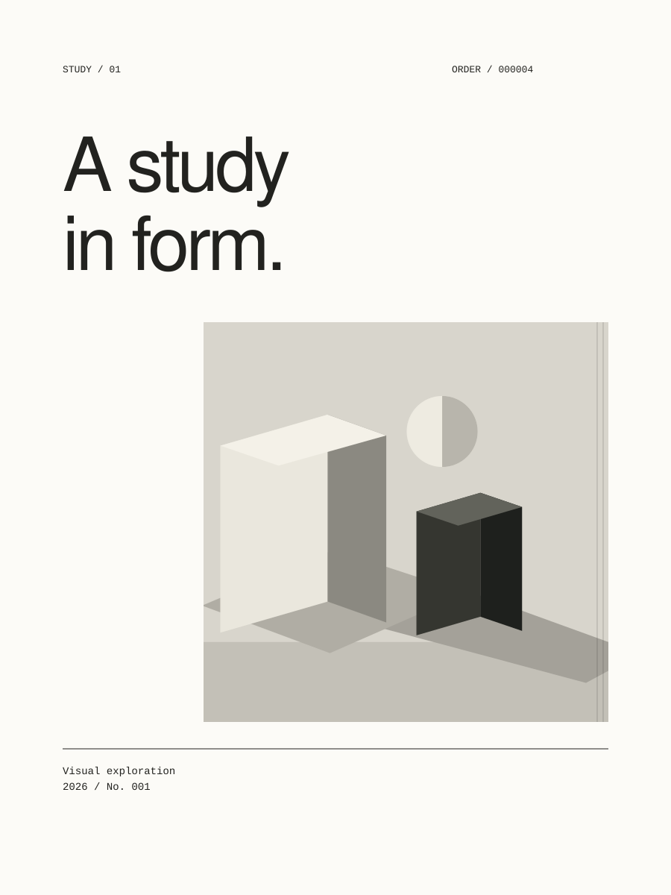

# STUDY/01

A browser composition instrument. Generate image-and-type studies with ORDER, SILENCE, and TENSION, then develop and export selected variations.

The interface uses Vite, React, and TypeScript. A separate TypeScript engine generates deterministic composition documents. The checked-in version is `0.2.0`. Artwork quality is still under review.



## Run locally

Use Node.js 26.8.1 with npm. The project was developed and tested on that version, and `package.json` sets no `engines` range. Tests import TypeScript through Node's native support. No backend or API key is required.

```sh
git clone https://github.com/notlestat/study-01.git
cd study-01
npm ci
npm run dev
```

Open the address printed by Vite. Follow [Make and export a study](docs/make-a-study.md) to generate, develop, save, and export artwork.

Saved studies and session recovery belong to the browser origin. They do not sync through GitHub or appear on another device. Export work you need to keep before clearing browser data or changing origins.

## Check a change

From the repository root, run:

```sh
npm test
npm run build
```

The build includes TypeScript checks. To inspect the production build, run `npm run preview` after building. To check exports in development, keep Vite running and open `/scripts/verify-export.html`, then choose **Run export checks**.

Compare visual output with the [frozen baseline](public/benchmarks/baseline/index.html) and [current review sheet](public/benchmarks/current/index.html). Run `npm run benchmark:current` to regenerate the current sheet. Preserve the frozen baseline.

## Find the implementation

| Location | Purpose |
| --- | --- |
| [src/engine/](src/engine/README.md) | Deterministic generators and transformations |
| `src/domain/` | Composition input and document types |
| `src/processing/` | Pixel transformations and PASS worker |
| `src/lib/` | Image decoding, browser storage, and exports |
| `src/app/` | React session and panel wiring |
| `src/components/` | Controls and composition renderer |
| `src/styles/` | Layout and design tokens |

Read the [reference](docs/reference.md) for workspaces, shortcuts, locks, storage behavior, and limits. [DEVELOPMENT.md](DEVELOPMENT.md) records implementation and visual decisions. The operator directs and selects the work. Codex helps with implementation and checks.
